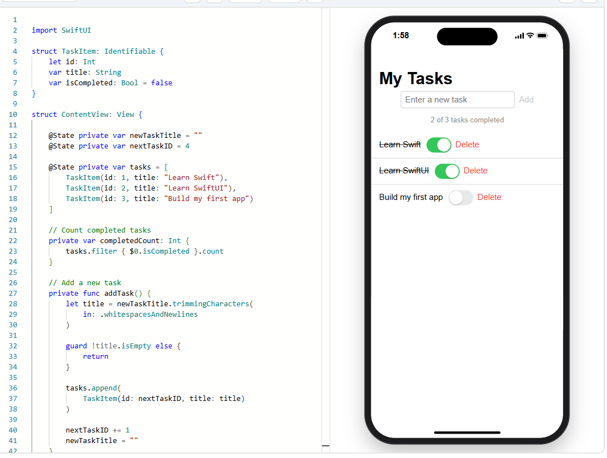

# swiftui-task-tracker
A simple task-management application developed as a self-directed learning project while exploring Swift and SwiftUI.

Features:
Add new tasks.
Mark tasks as completed or incomplete.
Display a dynamic completion counter.
Validate user input and prevent empty tasks.
Interactive task list with SwiftUI components.

Technologies & Concepts:
Swift,
SwiftUI,
Structs and data modeling,
State management (@State),
Data binding,
Arrays and collection operations,
Computed properties,
User interaction and input validation

Learning Objectives:
This project was created to develop practical knowledge of iOS application development, Swift programming fundamentals,
declarative UI development, and state-driven user interfaces.

Development Environment:

Developed and explored using a browser-based SwiftUI playground on Windows 10.

## Screenshots

### Main Screen

